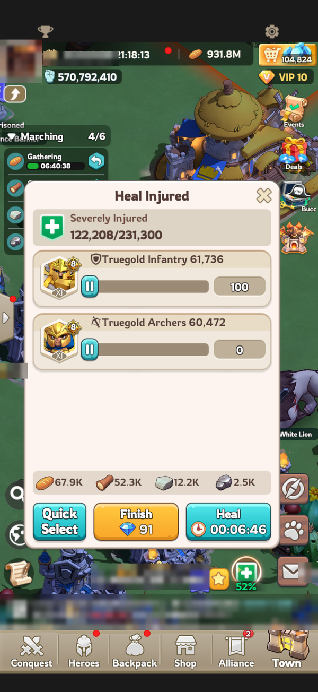
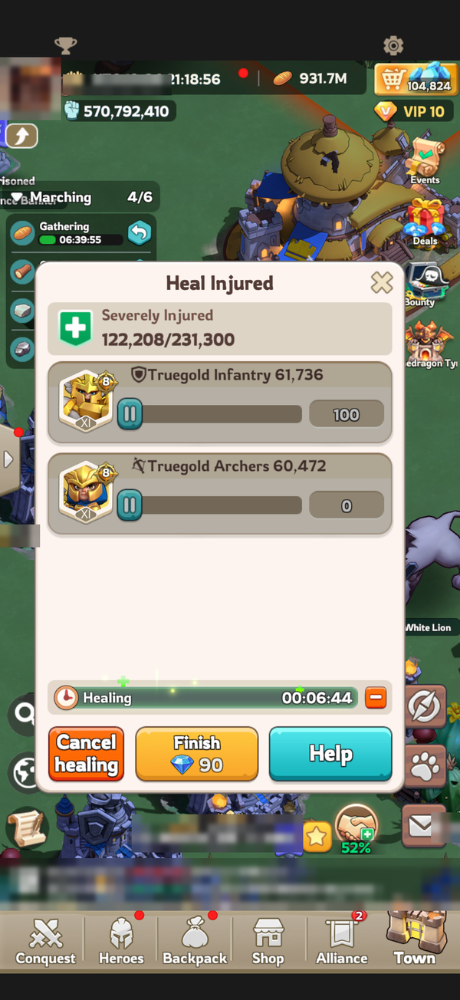

# iPhone Tapper

Presses buttons in iPhone games for you, controlled from your Mac. It comes with ready-made **recipes**, for example healing all your troops in Kingshot.

It looks at the phone screen before every tap and only presses the buttons the recipe allows. Everything else, like Speed Up or buttons that cost gems, is never touched.

## Recipes

### Kingshot: heal troops

```sh
deno task kingshot-heal
```

Open the **Heal Injured** window in Kingshot and start the recipe. It presses **Heal**, then **Help**, then **Heal** again, until all your troops are healed.

| It presses **Heal** | Then **Help** |
| --- | --- |
|  |  |

If the button shows **Speed Up** or anything else, it waits until **Heal** comes back.

**It heals more when more allies help.** It starts with 60 Infantry per round, or more if you tell it how many allies are online:

```sh
deno task kingshot-heal --allies 5
```

Every 10th round it reads the "5 Allies have helped you" message and sizes the batch to that. When 10 heals in a row finish within 3 seconds of Help, it also tries one ally more. Slower heals mean the allies are at their limit, so it stops growing. It reads the tier badge (XI or X) on the top troop and uses the right amount per ally: 60 for XI and 140 for X. How much one ally heals is different for every player, so change `TROOPS_PER_ALLY_XI` and `TROOPS_PER_ALLY_X` in the [settings](#settings) to match yours.

**It cancels heals the allies cannot finish.** It remembers how many allies each heal was sized for. If fewer help and the heal has not finished 10 seconds after Help, it presses **Cancel healing** and **Confirm** (all resources are refunded) and starts over with a smaller batch.

It only heals Infantry: when it changes the batch it also sets the Archers and Cavalry boxes to 0. After a cancel it keeps the smaller batch for 5 minutes before growing again.

**It stops when allies stop helping.** At the smallest batch it waits up to 4 minutes for the heal timer, then stops by itself.

## What you need

- A Mac with Apple Silicon (M1 or newer)
- An iPhone and a USB cable
- An **Apple ID**. A free one works. A paid Apple Developer account is optional (see [Free or paid Apple account](#free-or-paid-apple-account)).
- **Nix**. The project's flake gives you all the tools it needs.

**Not using Nix?** Install [Deno](https://deno.com) instead with `curl --fail --silent --show-error --location https://deno.land/install.sh | sh`, install Xcode from the App Store, and skip every `nix develop` below.

## First time setup

Do this once.

1. **Get the project**
   ```sh
   nix run nixpkgs#git -- clone https://github.com/ixDevAB/iphone-tapper.git
   cd iphone-tapper
   nix develop
   ```
   `nix develop` gives you all the tools for this project. Run it every time you open a new Terminal.

2. **Install Xcode**
   Sign in to the App Store app on your Mac first, then:
   ```sh
   mas install 497799835
   ```
   This takes a while. Open Xcode once when it is done and accept the license.

3. **Sign in to Xcode**
   In Xcode, go to Xcode > Settings > Accounts, press **+** and sign in with your Apple ID.
   Select your account, press **Manage Certificates**, press **+** and choose **Apple Development**.

4. **Connect the phone**
   Plug the iPhone into the Mac, unlock it and tap **Trust** if it asks.
   In Xcode, go to Window > Devices and Simulators, and wait until the phone shows up.

5. **Turn on Developer Mode on the iPhone**
   See [Developer Mode on the iPhone](#developer-mode-on-the-iphone) below. When it is on, Xcode shows the phone without warnings.

6. **Start a recipe**
   ```sh
   deno task kingshot-heal
   ```
   The first start installs a helper app on your phone. This takes a few minutes. After that, starting is quick.

7. **Free Apple ID only:** the phone will say **Untrusted Developer**. Go to Settings > General > VPN & Device Management, tap your Apple ID and **Trust**. Then start the recipe again.

## Developer Mode on the iPhone

Developer Mode lets your Mac install the helper app on the phone. You only turn it on once.

1. **Connect the phone to the Mac first** (step 4 above), with Xcode open. The Developer Mode switch does not show up on the phone until it has been connected to a Mac with Xcode.
2. On the iPhone, open **Settings > Privacy & Security**.
3. Scroll all the way down to **Developer Mode** and tap it.
4. Turn the switch **on** and tap **Restart**.
5. After the restart, unlock the phone. A message asks if you want to turn on Developer Mode: tap **Turn On** and enter your passcode.

**Don't see Developer Mode?** Unplug the phone, plug it in again with Xcode open, wait a minute, and look again. You can also check that the phone is on a recent iOS version (Settings > General > Software Update).

**To turn it off later:** Settings > Privacy & Security > Developer Mode > off. The recipes stop working until you turn it on again.

## Every time you use it

1. Plug in the iPhone and unlock it.
2. Open the game on the right screen, for Kingshot the **Heal Injured** window.
3. In Terminal:
   ```sh
   cd iphone-tapper
   nix develop
   deno task kingshot-heal
   ```
4. Leave the phone alone. You will see "Automation Running" on the phone, that is normal.
5. Press **Ctrl + C** in Terminal to stop. It also stops by itself when there has been nothing to press for 10 minutes.

**Tip:** set Settings > Display & Brightness > Auto-Lock to **Never** while it runs. When the phone locks, it stops accepting taps.

## Free or paid Apple account

| | Free Apple ID | Paid Apple Developer ($99/year) |
| --- | --- | --- |
| Works | Yes | Yes |
| Helper app lasts | 7 days, then run `deno task rebuild` | 1 year |
| Trust prompt on the phone | Once | No |

## Settings

Most people do not need to change anything. To change a setting, create a settings file once:

```sh
cp .env.example .env
open -e .env
```

Change a value, save, and start again.

| Setting | What it does | Default |
| --- | --- | --- |
| `TEAM_ID` | Which Apple developer team signs the helper app | Found automatically |
| `BUNDLE_ID` | Name of the helper app on the phone | Made from your team |
| `INTERVAL_MS` | Pause after each tap, in milliseconds | `0` |
| `MAX_IDLE_SECONDS` | Stop when there has been nothing to press this long | `600` |
| `CLOCK` | Time format in the output: `24h` (14:52:08) or `12h` (2:52:08 PM) | `24h` |
| `TROOPS_PER_ALLY_XI` | Kingshot: how many tier XI troops one helping ally heals | `60` |
| `TROOPS_PER_ALLY_X` | Kingshot: how many tier X troops one helping ally heals | `140` |
| `TROOPS_PER_ALLY` | Kingshot: troops per ally for any other tier | `60` |
| `ALLY_TIMEOUT_SECONDS` | Kingshot: at the smallest batch, stop when a heal has not finished this long after Help | `240` |
| `CANCEL_AFTER_SECONDS` | Kingshot: cancel a bigger heal that has not finished this long after Help | `10` |
| `START_ALLIES` | Kingshot: how many allies to size the first batch for (same as `--allies`) | `1` |
| `GROW_AFTER_ROUNDS` | Kingshot: try one ally more after this many heals in a row finished | `10` |
| `CHECK_ALLIES_EVERY` | Kingshot: read how many allies helped every N rounds | `10` |
| `FAST_FINISH_SECONDS` | Kingshot: a heal only counts toward growing if it finished this fast after Help | `3` |
| `MAX_ALLIES` | Kingshot: never size a batch for more allies than this | `20` |
| `HOLD_AFTER_CANCEL_SECONDS` | Kingshot: after a cancel, do not grow the batch again for this long | `300` |
| `DEVICE_UDID` | Pick a specific iPhone if several are connected | First connected iPhone |

The recipes are made on an iPhone 17 Pro. On other models the buttons sit elsewhere and the recipe tells you it does not fit.

## When something goes wrong

| What you see | What to do |
| --- | --- |
| `command not found: deno` | Run `nix develop` first. |
| `no iphone found` | Plug in the cable, unlock the phone, try again. |
| `is not reachable` | Unlock the phone and keep it unlocked while starting. |
| `no apple development certificate found` | Do step 3 of the first time setup. |
| `several developer teams found` | Create the settings file and copy one of the `TEAM_ID=` lines it shows into it. |
| `the phone stopped accepting taps` | The phone locked. Unlock it, set Auto-Lock to Never and start again. |
| `lost the connection to the phone` | The cable came loose or the phone locked. Plug it in, unlock it and start again. |
| `xcodebuild failed, see build.log` | Check that you are signed in to Xcode and that the phone is unlocked. |
| `webdriveragent did not start` | Unlock the phone, run `deno task rebuild`. |
| The phone says **Untrusted Developer** | Settings > General > VPN & Device Management, tap your Apple ID and **Trust**. |
| It worked last week but not today | Run `deno task rebuild` to reinstall the helper app. |

**Tip for direnv users:** run `direnv allow` once and the tools load by themselves when you enter the folder, so you can skip `nix develop`.

## Good to know

- Tapping automatically may break the game's rules, and accounts can get banned for it. Use it at your own risk.
- The game still decides the timers. This only presses the buttons for you.
