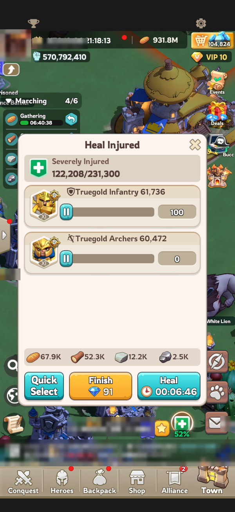

# iPhone Tapper

Presses buttons in iPhone games for you, controlled from your Mac. It comes with ready-made **recipes**, for example healing all your troops in Kingshot.

It looks at the phone screen before every tap and only presses the buttons the recipe allows. Everything else, like Speed Up, is never touched, and gems are only spent where a task says so (the VIP XP item at the Nomadic Merchant).

## Recipes

| Command                              | What it does                                                                        |
| ------------------------------------ | ----------------------------------------------------------------------------------- |
| `just heal`                          | Heals your troops with the help of your allies                                      |
| `just calibrate`                     | Measures how many troops one helping ally heals                                     |
| `just intel`                         | Does the intel missions                                                             |
| `just terror-hunt 3`                 | Holds Terror rallies                                                                |
| `just collect-pet`                   | Pet skills, pet adventures and ally treasure                                        |
| `just claim-mail`                    | Reads and claims all mail                                                           |
| `just claim-alliance`                | Alliance chests and contributions                                                   |
| `just alliance-members XLE WOO`      | Saves the name and player ID of every member of an alliance                         |
| `just recruit`                       | The free hero recruits                                                              |
| `just shop`                          | Buys from the Nomadic Merchant with resources                                       |
| `just claim-freebies`                | Free items in the store                                                             |
| `just claim-vip`                     | The daily VIP claims                                                                |
| `just collect-daily`                 | Claims the daily missions                                                           |
| `just collect-conquest`              | Claims the Conquest idle income                                                     |
| `just collect-backpack`              | Uses gems, hero XP, the small resource items, the plain chests and VIP XP items     |
| `just train-troops`                  | Collects finished troops and trains new ones                                        |
| `just collect-water`                 | Collects the water on your island                                                   |
| `just island-locate-water`           | Finds where your Purifier is, for `collect-water`                                   |
| `just collect-online`                | Claims the Online Rewards chest                                                     |
| `just mystic-trial`                  | Plays the Mystic Trials with your troop ratios                                      |
| `just morning`                       | All of the tasks above, once                                                        |
| `just evening`                       | The morning round without the Terror rallies, the store freebies and the VIP claims |
| `just collect-all`, `just claim-all` | Four collect tasks, or four claim tasks                                             |
| `just run`                           | Keeps doing all of it through the day                                               |
| `just runs`                          | Shows what ran and when                                                             |
| `just decisions`                     | Shows what the tasks read, tapped and decided, step by step                         |
| `just backpack-names`                | Saves a named picture of every item in the Backpack                                 |

Each task only takes its own arguments. One it does not know stops it before anything is pressed, and the message lists the ones it takes.

### Heal troops

```sh
just heal
```

Start the recipe on the world map or with the **Heal Injured** window open. If the window is not open, it presses the green injured button (the plus with a percentage) to open it. It presses **Heal**, then **Help**, then **Heal** again, until all your troops are healed.

| It presses **Heal**                                                                         | Then **Help**                                                                                              |
| ------------------------------------------------------------------------------------------- | ---------------------------------------------------------------------------------------------------------- |
|  |  |

If the button shows **Speed Up** or anything else, it waits until **Heal** comes back.

**It heals more when more allies help.** It starts with 60 Infantry per round, or more if you tell it how many allies are online:

```sh
just heal --allies 5
```

On the first round and every 10th round after that it reads the "5 Allies have helped you" message and sizes the batch to that. If it could not read that message for a while and 10 heals in a row finish within 3 seconds of Help, it tries one ally more. Slower heals mean the allies are at their limit, so it stops growing. It reads the tier badge (XI or X) on the top troop and uses the right amount per ally: 60 for XI and 140 for X. How much one ally heals is different for every player, so change `TROOPS_PER_ALLY_XI` and `TROOPS_PER_ALLY_X` in the [settings](#settings) to match yours.

On those same rounds it prints how many injured troops are left and roughly how long that will take at the current pace.

**It cancels heals the allies cannot finish.** It remembers how many allies each heal was sized for. If fewer help and the heal has not finished 10 seconds after Help, it presses **Cancel healing** and **Confirm** (all resources are refunded) and starts over with a smaller batch.

It only heals Infantry: when it changes the batch it also sets the Archers and Cavalry boxes to 0. After typing a new amount it reads the box back, and if the box shows something else it carries on with what the box shows. After a cancel it keeps the smaller batch for 5 minutes before growing again.

**It stops when allies stop helping.** At the smallest batch it waits up to 4 minutes for the heal timer, then stops by itself.

### Measure troops per ally

Use this to find your own `TROOPS_PER_ALLY_XI` and `TROOPS_PER_ALLY_X` instead of guessing them.

1. Open the **Heal Injured** window when allies are online. The tier you want to measure must be one of the three troops at the top.
2. Start it:
   ```sh
   just calibrate
   ```
3. It heals 10 Infantry, then 20, then 30, and so on, pressing **Help** each time and reading how many allies helped:
   ```
   14:36:32 300 troops finished with 6 assists (50.0 per assist), one assist heals at least 50.0 and no upper limit yet
   14:36:47 310 troops finished with 5 assists (62.0 per assist), one assist heals at least 62.0 and no upper limit yet
   14:37:02 320 troops did not finish, cancelled with 4 assists (80.0 per assist), one assist heals at least 62.0 and less than 80.0
   ```
4. A heal only counts when the assists finish it within 3 seconds of Help (`FAST_FINISH_SECONDS`), the same rule the heal recipe uses. A heal that is still running after that is cancelled (all resources are refunded). A heal that finishes in time but only because the last few seconds ran out on its timer does not count either. From then on it picks amounts between "at least" and "less than" and keeps going until the two are less than one troop apart. If the very first heal does not finish, it goes back to your current setting times the number of assists, and from there down in steps until one finishes.
5. Then it confirms the result: it heals that many troops per assist until 5 heals have finished with exactly the expected number of assists. If one of them does not finish, it lowers the value by 1 and starts the 5 over.
6. It stops and prints the result, for example `TROOPS_PER_ALLY_XI=62`. The rounds may have been lucky, so it suggests one less (`61`) as the safer choice, and that is the value `--save` writes.
7. Run it again with `--tier X` for the next tier.

It starts small on purpose. To get to the limit faster, start higher, and use a smaller step for a more exact result:

```sh
just calibrate --start 300 --increment 5
```

It measures tier XI unless you name another tier. It finds the first troop with that badge among the three at the top of the window, so you can measure X while XI troops are still injured:

```sh
just calibrate --tier X --start 100
```

A reading that contradicts what already failed is thrown away: if 66 per assist failed, a later heal that seems to finish at 78 per assist means the assist count was read wrong.

It remembers the best amount so far and the lowest amount that failed for each tier in `build/calibrate.json`, so you can stop it with Ctrl + C and the next run continues where it was. Add `--fresh` to forget that and start over.

The short forms `-t`, `-s`, `-i` and `-a` work for `--tier`, `--start`, `--increment` and `--allies`. An argument it does not know stops it before anything is pressed.

Add `--save` to write the safer value (the result minus one) to `.env`, so the heal recipe uses it from the next start:

```sh
just calibrate --start 300 --save
```

It only presses **Heal** when the amount box shows the amount it typed. If the Heal button is not showing at the start, it waits up to 30 seconds for it.

### Intel missions

```sh
just intel
```

Open the world map (or the Intel Mission screen) and start it. For every marker it presses **View** and then does what the mission needs:

| Marker | What it presses                                               |
| ------ | ------------------------------------------------------------- |
| Tent   | **Rescue**                                                    |
| Animal | **Attack**, then **Deploy** with the troops the game suggests |
| Fight  | **Conquer**, then **Fight** with the squad already set        |

It does not wait for marches: it sends one and takes the next marker right away, as long as a marker is left that it has not sent. A marker with a green check is finished and is left for **Claim All**. Only when every marker is sent does it give the ones still on the way up to 30 seconds, press **Claim All**, and carry on with any markers that show up after that. It also collects before it stops for lack of stamina.

It never attacks the Gilded Baron (Rebel Bounty). It leaves his marker, the hexagon with flames, alone, and it does not press **Attack** on a target whose name says Rebel Bounty or Gilded Baron. For any other animal it backs out without sending when the Deploy screen says the deployment will fail.

When it stops with markers still open it says how many and why (`markers left: 1 sent but not finished, 1 rebel bounty left alone`) and saves the screen in `build/intel-end.png`.

Animals need a free march. When the march list on the world map shows all marches in use (for example 6/6), it waits up to a minute for one to come back, and skips that animal if none does. Tents and fights do not need a march.

```sh
just intel --pan
just intel --storehouse --embrace --stamina 50
```

- `--pan` presses the Pan skill once at the start, if it is available.
- Without more arguments it stops when the stamina is below 12.
- `--storehouse` lets it claim the Gourmet Feast (150 stamina) when it runs out.
- `--embrace` lets it claim the Comforting Embrace (50 stamina).
- `--stamina 50` lets it gain up to 50 stamina from meat, 10 at a time.

It never presses **Buy & Use** or anything else that costs gems.

When it stops it prints what it did and what it collected:

```
intel done: 6 (3 animals, 1 tent, 2 fights)
  animals: 2 blue, 1 purple
  tents: 1 purple
  fights: 2 gold
rewards:
  15,000 hero xp
  3 epic conquest skill book
  2 shards of edwin
  250 activity triumph points
```

It recognises rewards by their picture, see [Name the rewards](#name-the-rewards).

### Terror rallies

```sh
just terror-hunt 3
```

Start it on the world map. For each rally it opens the search, picks **Terror** at level 8 by reading the name under the tile (it scrolls the list back when it shows the resources instead, and stops when it cannot find Terror rather than search for something else), presses **Search**, **Rally**, **Hold a rally** (with the rally time the game has selected) and **Deploy**. The number is how many rallies to hold; without it, it holds one.

```sh
just terror-hunt 3 --level 7
just terror-hunt 2 --cav fahd --arch diana
just terror-hunt 5 --storehouse --stamina 50
```

- `--level 7` hunts another level.
- `--arch`, `--inf` and `--cav` put a hero in the rally by name. It opens **Select Heroes**, finds the hero by its picture and presses **Change**. The pictures are in `assets/heroes`, named after the hero. A hero it has no picture of yet is looked up once through **View** and saved there. With heroes named, it waits for the rally to come back before it starts the next one, because the heroes have to be home again.
- Without heroes it starts the next rally right away, as long as a march is free.
- A rally costs 25 stamina. `--storehouse`, `--embrace` and `--stamina 50` refill it the same way as for the intel task; without them it stops when the stamina runs out.

### Collect from the pets

```sh
just collect-pet
```

Start it on the world map. It opens the pet skills and uses **Scent Mastery** and **Gift of the King** when they are ready, or tells you how long their cooldown still is. Then it goes to **Beast Cage** and **Adventure**, where it:

- presses **Claim All** when adventures have finished
- presses **Hunt All** to send the pets out again (each hunt costs 10 stamina, so it stops hunting when the game says there is not enough)
- opens **Ally Treasure** when it has a red bubble, presses every **Share**, and presses **Claim** under Alliance Shares while claims are left for today

It prints everything it collected at the end, the same way as the intel task.

### Claim the mail

```sh
just claim-mail
```

Start it on the world map. It opens the mail, goes through the five tabs (Wars, Alliance, System, Reports, Starred) and presses **Read & Claim All** on each. It never presses **Delete Read**. At the end it prints what it claimed.

### Claim from the alliance

```sh
just claim-alliance
```

Start it on the world map. It opens **Alliance**, then:

- **Chests**: opens the big chest at the top when it has a red dot, then presses **Claim All** on the Alliance Gift tab and on the Loot Chest tab
- **Tech**: opens **Covenant-Making** and presses the bread **Contribute** button until the attempts are down to 0

It never presses the gem Contribute button or **Go**. At the end it prints what it claimed.

### Alliance member lists

```sh
just alliance-members
just alliance-members XLE WOO VAL EVL RYL GRD
just alliance-members --all
just alliance-members GRD --limit 3
just alliance-members XLE --power
```

Start it anywhere in the game. Without a name it takes your own alliance, with names those alliances, and with `--all` every alliance in the Alliance Power list. It goes to your profile, **Leaderboard**, **Alliance Power**, opens the alliance and its **Members**, and then opens one rank group at a time. For every member it presses **View**, reads the name and the ID from the profile and goes back. It only reads: it never presses **Join**, **Chat** or **Remove Friend**.

Each alliance gets its own file in the project folder, named after the alliance and its kingdom, and git ignores these files:

```
alliance_members_KON_323.json
```

```json
{
  "scannedAt": "2026-11-23",
  "alliance": "KON",
  "kingdom": "323",
  "count": 86,
  "r5": [{ "username": "King Rupert", "playerId": "50499879", "power": "330.3M" }],
  "r4": [],
  "r3": [],
  "r2": [],
  "r1": [],
  "skipped": [{ "username": "peatas", "rank": "R3", "why": "no menu opened" }]
}
```

- The file is written after every member, so stopping halfway loses nothing.
- Type the alliance tag with the same capitals as in the game: `XLE` and `xLe` are two alliances. A small letter gets a dash after it in the file name (`alliance_members_x-Le-_323.json`), because the Mac treats `xLe` and `XLE` as the same file name.
- A player whose name is already in the file is not opened again. Run it again to pick up new members; a second run mostly scrolls.
- A name with unusual letters is read differently on the list than on the profile. The first time that happens the player is opened once more, and the list reading is kept in `alliance_members_names.json` so it does not happen again.
- A first run takes about 12 seconds per player, so 15 to 20 minutes for a full alliance.
- At the end it says how many players it saved and what the game says the alliance has. If the two differ, run it again.
- A player it could not read is tried once more at the end of their rank. Whoever is still unread is listed in `skipped` in the file, on a `not read` line at the end of the alliance and in `decisions.log`, with the reason and a picture in `build/`. Show them with `jq '.skipped' alliance_members_XLE_323.json`.
- Each player's `power` is saved as the game shows it (`517.4M`, `1.4B`). Every run updates it from the member list for the players it scrolls past. `--power` does only that: it scrolls through the alliance, opens nobody, and says how many it updated and whose power it could not read.
- `--limit 3` stops after three profiles per alliance, for a quick try.
- Your own card opens no menu in the game, so you are not in the list of your own alliance unless you add yourself.

### Free hero recruits

```sh
just recruit
```

Start it on the world map. It opens **Heroes** and **Recruit Heroes** and presses every green **Free** recruit button. It never presses the yellow buttons that cost keys. When nothing is free it tells you how long until the next one.

### Nomadic Merchant

```sh
just shop
just shop --buy-vip
just shop --buy-vip --dry-run
```

Start it on the world map. It opens **Shop** and buys every Nomadic Merchant item that costs resources (bread, wood, stone, iron). When only gem items are left it presses **Free Refresh** and starts over, until there is no free refresh left.

It never buys with gems, with one exception: with `--buy-vip` it also buys the VIP XP item (the yellow V). A gem purchase opens a **Buy** window, and it only confirms when that window says VIP XP and shows the price it read in the list. The game then asks **Confirm to spend 15 gems to purchase this item?** It answers only when that amount, the price in the Buy window and the price in the list are the same number; otherwise it closes the question and stops. It leaves **Don't show this again today** alone.

With `--dry-run` it opens every item it would buy, says where it would press the buy button, closes the window again and presses no **Free Refresh**. Nothing is bought.

### Free items in the store

```sh
just claim-freebies
```

Start it on the world map. It opens the store (the shopping cart), opens every tab that has a red dot, and scrolls down through it looking for things marked **Free**, **Claimable** or **Claim**. It claims those. It never presses a button with a price on it, and it skips a label that sits next to a price.

The store looks different every day, so it goes by what it sees: a small red dot on a tab means something in that tab can be claimed, and inside the tab it taps what is labelled **Free**, **Claimable** or **Claim**, or what has a red dot of its own. Where a tab has a reward track (a row of rewards over the numbers 1, 3, 6 and so on), it taps every step once; a step that is not reached yet only shows what it holds. The red circle with an exclamation mark at the edge of the tab row only says that a tab with a dot is further along; it pages through all the tabs anyway.

### VIP claims

```sh
just claim-vip
```

Start it on the world map. It opens the VIP screen and claims the **daily free bundle** and the **daily sign-in chest**, then uses the VIP XP items you own. It never presses **Buy & Use**.

### Daily missions

```sh
just collect-daily
```

Start it on the world map. It opens the daily missions (the scroll icon), goes to the **Daily** tab and presses **Claim All** until nothing is left.

### Conquest idle income

```sh
just collect-conquest
just collect-conquest --force
```

Start it on the world map. When the **Conquest** button has a red dot, it opens Conquest and claims the idle income. Without the dot it does nothing, unless you add `--force`.

### Backpack

```sh
just collect-backpack --dry-run
just collect-backpack
just collect-backpack --rss grey,green,blue
```

Start it on the world map. It opens the **Backpack**, goes through the **Resources** and **Other** tabs, and uses a whole stack at a time of:

- all gems
- all hero XP
- the grey and green resource items (bread, wood, stone, iron, also the secured ones)
- Governor Gear Materials Chest, Trial Chest, Badland Treasure, Reserve Chest and Countess Chest
- 10 VIP XP and 100 VIP XP

It knows the items by their pictures in `assets/backpack` and only opens the ones it is going to use. An item it has no picture of yet is opened once to read its name, and its picture is saved. It uses nothing else, and it confirms the alert about the city protection limit. At the end it opens every tab once to clear the red dots.

`--rss` picks which resource colours to use: `grey` (100), `green` (1K), `blue` (10K and 100K), `purple` (1M).

The picture only decides which tiles get opened. Using items cannot be undone, so before it presses **Use** the name it reads from the open item must be on the list above, and for resources the colour of the tile that is actually open must match the size in that name. Otherwise the item is left alone. Try `--dry-run` first: it opens and closes the items and prints `would use all: ...` for each one, without ever pressing **Use**.

### In the town: troops, water and the online reward

```sh
just train-troops
just collect-water
just island-locate-water
just collect-online
```

These start on the world map or the town map and end on the world map. They find their way through the list at the side of the town map.

- `train-troops` goes through the Barracks, the Stable and the Range. Where nothing is training it presses **Train** with the tier and amount the game suggests, which also collects the finished troops. It never presses **Finish** or **Speedups**.
- `collect-water` goes to your island and collects from the Fountain of Life, and from the Purifier when `ISLAND_PURIFIER` in `.env` says where it is.
- `island-locate-water` finds that place with your help, because everyone has built their island differently: it shows the island piece by piece, you tap your Purifier until its buttons show, and it writes `ISLAND_PURIFIER` to `.env`. Run it again when you move the Purifier.
- `collect-online` opens the Online Rewards chest at the storehouse when it is ready, and tells you when the next one is.

### Mystic Trial

```sh
just mystic-trial
```

Start it on the world map or the town map. It finds the trial in the list at the side of the town map, scrolling the list when it is further down. In every trial that is open today it:

1. presses **Raid** and **Claim** when the trial offers the raid rewards
2. presses **Challenge**, sets your troop ratio with **Balance**, presses **Deploy** and skips the fight
3. presses **Retry** after a lost fight, until that trial has no attempts left (a won fight moves on to the next stage by itself)
4. opens **Battle Report** and presses **Read All**

Radiant Spire fights with three squads: there it presses **Quick Deploy**, opens **Edit Formation** for each squad to set the ratio, and then presses **Deploy**.

The ratios are infantry/cavalry/archer in `.env`, one line per trial. A trial without a line is skipped:

```
TRIAL_KNOWLEDGE_NEXUS=50/10/40
TRIAL_MOLTEN_FORT=60/15/25
```

It only deploys when the Troop Ratio line on the screen shows exactly your numbers. In the rounds it is played once a day, see [Evening round](#evening-round).

### Morning round

```sh
just morning --pan --gourmet --embrace
```

Start it on the world map or the town map; it goes to the world map by itself first, and closes a window that is still open. It runs sixteen tasks one after the other and returns to the world map between them:

1. the intel missions (`--pan`, `--gourmet`, `--embrace` and `--stamina 50` work as for the intel task; `--gourmet` is the same as `--storehouse`)
2. two Terror rallies with Diana as archer and Fahd as cavalry (change with a number, `--arch`, `--cav`, `--inf` and `--level`)
3. all the mail
4. the alliance chests and contributions
5. the Nomadic Merchant (with `--buy-vip` also the VIP XP item for gems)
6. the free hero recruits
7. the pet skills, pet adventures and ally treasure
8. the free items in the store
9. the VIP claims
10. the Conquest idle income (only with a red dot, or with `--force`)
11. the Backpack (gems, hero XP, grey and green resources or the colours from `--rss`, the plain chests and VIP XP items)
12. troop training in the Barracks, the Stable and the Range
13. the water on your island
14. the Online Rewards chest
15. the Mystic Trials
16. the daily missions, last so it also claims what the other steps completed

`--dry-run` goes to the Nomadic Merchant and the Backpack: both only say what they would buy or use.

If one task stops early, the round carries on with the next one. The tasks that only make sense once a day (the Terror rallies, the store freebies, the VIP claims and the Mystic Trials) are left out when they already went well today, see [What ran and when](#what-ran-and-when).

### Evening round

```sh
just evening --pan --gourmet --embrace
```

The morning round without the Terror rallies, the store freebies and the VIP claims. It runs the other thirteen in the same order and takes the same arguments, except the ones for the Terror rallies.

The Mystic Trials are in both rounds, but only played once a day: when the run log shows they already went well today, the round leaves them out and says so. A trial that still has attempts because the task stopped early is picked up by the next round.

### Your own arguments for the rounds

Everyone plays differently, so the arguments you always use can live in your own `.env` instead of being typed every time:

```
MORNING_ARGS=--pan --gourmet --embrace --buy-vip
EVENING_ARGS=--pan --gourmet
RUN_ARGS=--buy-vip
```

`just morning` then runs as if you had typed them, and says so when it starts. What you type after the task still counts and is added to them. The same works for every task: the setting is the task's name in capitals with `_ARGS` after it, for example `INTEL_ARGS=--pan` or `TERROR_HUNT_ARGS=2 --arch diana --cav fahd`.

### Collect all and claim all

```sh
just collect-all
just claim-all
```

`collect-all` runs the pets, Conquest, the Backpack and the daily missions, one after the other. `claim-all` runs the mail, the alliance, the store freebies and VIP. The town tasks and the Mystic Trials are not part of either. Both start on the world map, and the arguments of the single tasks still work, for example `just collect-all --force --rss grey,green,blue`.

### Keep running all day

```sh
just run --pan --gourmet --embrace
```

Start it on the world map and leave it. It starts every task that is due, in the same order as the morning round, and starts each one again when it is due the next time. The very first time that is all of them. In between it sleeps and tells you until when.

| Task                                                                      | Runs again                                              |
| ------------------------------------------------------------------------- | ------------------------------------------------------- |
| recruit                                                                   | when the next free recruit is ready                     |
| shop                                                                      | when the merchant refreshes                             |
| collect-online                                                            | when the next chest is ready, at least 15 minutes apart |
| claim-mail, claim-alliance                                                | every 2 hours                                           |
| intel                                                                     | every 3 hours                                           |
| collect-pet, collect-conquest, collect-daily, train-troops, collect-water | every 4 hours                                           |
| collect-backpack                                                          | every 12 hours                                          |
| claim-freebies, claim-vip, terror-hunt, mystic-trial                      | once a day                                              |

```sh
just run --only recruit,shop
just run --skip terror-hunt,intel
```

`--only` runs just the tasks you list, `--skip` leaves some out. The other arguments work as for the morning round. Keep the phone unlocked on the game, on the cable, and keep the Mac awake.

A task that meets a screen it does not know stops, saves a picture of that screen in `build/`, and gets a new turn 30 minutes later. When you stop and start `just run` again, it carries on with the schedule it had: nothing runs before it is due.

### What ran and when

```sh
just runs
just runs 100
```

```
2026-11-21 17:23  claim-vip            9s  ok  next 2026-11-22 01:00
2026-11-21 17:24  claim-freebies     188s  ok  next 2026-11-22 01:00
2026-11-21 17:28  recruit             51s  failed: did not recognise the screen, see build/recruit-lost.png  next 2026-11-21 17:58
2026-11-21 17:32  recruit             25s  ok  next 2026-11-21 22:21
```

Every run is saved in `runs.db`, with how long it took, how it went and when the task is due again.

- The once a day tasks (terror-hunt, claim-freebies, claim-vip, mystic-trial) are left out of the rounds when they already went well since the game's daily reset. The reset is 00:00 UTC; change it with `DAY_RESET_UTC_HOUR`.
- `just run` reads its schedule from here when it starts.
- Add `--again` to a round or to `just run` to run everything now anyway.
- A task you start by itself always runs.

### Why did it do that?

```sh
just decisions
just decisions 200
just decisions 200 collect-pet
just decisions 50 "left alone"
```

Every task writes down what it does while it runs, in `decisions.log`: each time it reads the screen (with the texts it read and where they are), each tap, what it concluded, and every line it printed. Lines older than 7 hours are deleted each time a task starts. A task that does the same tap or drag more than 40 times in a row while the screen stays the same stops itself and says `stuck`. `claim-alliance` is allowed 200, because contributing presses one button many times. The number is how many lines to show, and words after it keep only the lines that contain them.

```
22:47:29 collect-backpack  read the screen: Backpack @92,77 | Resources @49,118 | 1,571 @176,433 | ...
22:47:30 collect-backpack  not opened row=500 column=4 item=1m wood (secured) why=it is purple and only grey, green may be used
22:47:31 collect-backpack  opening to use row=407 column=4 item=1k wood
22:47:31 collect-backpack  tapped x=343 y=407
22:47:33 collect-backpack  would use all row=407 column=4 item=1k wood pictured=1k wood before=green open=green
```

Look here when a task did something you did not expect, or left something alone: the texts show what it could and could not read at that moment. The file starts over when it gets large.

### Name everything in the backpack

```sh
just backpack-names
just backpack-names --tabs resources,speedups
```

Start it on the world map. It goes through the five Backpack tabs (Resources, Speedups, Bonuses, Gear, Other), taps every item to read its name and saves its picture as `assets/backpack/<name>.png`:

```
21:25:43 other: Corsair Key
21:25:54 other: Crescent Emblem
21:29:35 other: Elite Spices (54)
stopped: 192 items named, pictures in assets/backpack/
```

It only taps the item tiles, and the close cross on the gear details. It never presses **Use**, **Unequip** or anything else, and it stops if an item stays open when it should have closed. All tabs take about half an hour. Run it again when you get new items; pictures that are already there are kept.

```sh
open assets/backpack
```

### Name the rewards

The tasks print what they collected. They recognise each reward by its picture in `assets/rewards`, and the file name is the name they print. A reward they have not seen before is saved there as `unknown-20.png` and so on. To name it:

1. Find out what it is. The game shows the name when you tap an item wherever rewards are listed before you claim them: the Conquest idle income, an intel marker, the chests on the daily missions, or a reward mail. For things you own, look the picture up in `assets/backpack`.
2. Rename the file:
   ```sh
   mv "assets/rewards/unknown-20.png" "assets/rewards/arena token.png"
   ```

The same reward can have more than one picture: add `~2` to the name (`speedup~2.png`) and it prints under the same name.

### Without just

`just <recipe>` is short for `deno task start <recipe>`. If you do not have [just](https://just.systems) (it comes with `nix develop`), this does the same:

```sh
deno task start heal --allies 5
```

### Working on the code

```sh
just fmt
just check
just test
```

The tests need no phone. Run all three after every change. A new recipe goes in `recipes/<name>/` and is added to `src/recipes.ts` and the `justfile`, and to `recipes/all/steps.ts` when the rounds should run it.

## What you need

- A Mac with Apple Silicon (M1 or newer)
- An iPhone and a USB cable
- An **Apple ID**. A free one works. A paid Apple Developer account is optional (see [Free or paid Apple account](#free-or-paid-apple-account)).
- **Nix**. The project's flake gives you all the tools it needs.

**Not using Nix?** Install [Deno](https://deno.com) instead with `curl --fail --silent --show-error --location https://deno.land/install.sh | sh`, install Xcode from the App Store, and skip every `nix develop` below.

## First time setup

Do this once.

1. **Get the project**
   ```sh
   nix run nixpkgs#git -- clone https://github.com/ixDevAB/iphone-tapper.git
   cd iphone-tapper
   nix develop
   ```
   `nix develop` gives you all the tools for this project. Run it every time you open a new Terminal.

2. **Install Xcode**
   Sign in to the App Store app on your Mac first, then:
   ```sh
   mas install 497799835
   ```
   This takes a while. Open Xcode once when it is done and accept the license.

3. **Sign in to Xcode**
   In Xcode, go to Xcode > Settings > Accounts, press **+** and sign in with your Apple ID.
   Select your account, press **Manage Certificates**, press **+** and choose **Apple Development**.

4. **Connect the phone**
   Plug the iPhone into the Mac, unlock it and tap **Trust** if it asks.
   In Xcode, go to Window > Devices and Simulators, and wait until the phone shows up.

5. **Turn on Developer Mode on the iPhone**
   See [Developer Mode on the iPhone](#developer-mode-on-the-iphone) below. When it is on, Xcode shows the phone without warnings.

6. **Start a recipe**
   ```sh
   just heal
   ```
   The first start installs a helper app on your phone. This takes a few minutes. After that, starting is quick.

7. **Free Apple ID only:** the phone will say **Untrusted Developer**. Go to Settings > General > VPN & Device Management, tap your Apple ID and **Trust**. Then start the recipe again.

## Developer Mode on the iPhone

Developer Mode lets your Mac install the helper app on the phone. You only turn it on once.

1. **Connect the phone to the Mac first** (step 4 above), with Xcode open. The Developer Mode switch does not show up on the phone until it has been connected to a Mac with Xcode.
2. On the iPhone, open **Settings > Privacy & Security**.
3. Scroll all the way down to **Developer Mode** and tap it.
4. Turn the switch **on** and tap **Restart**.
5. After the restart, unlock the phone. A message asks if you want to turn on Developer Mode: tap **Turn On** and enter your passcode.

**Don't see Developer Mode?** Unplug the phone, plug it in again with Xcode open, wait a minute, and look again. You can also check that the phone is on a recent iOS version (Settings > General > Software Update).

**To turn it off later:** Settings > Privacy & Security > Developer Mode > off. The recipes stop working until you turn it on again.

## Every time you use it

1. Plug in the iPhone and unlock it.
2. Open the game on the screen the recipe starts from: the world map for nearly all of them.
3. In Terminal:
   ```sh
   cd iphone-tapper
   nix develop
   just heal
   ```
4. Leave the phone alone. You will see "Automation Running" on the phone, that is normal.
5. Press **Ctrl + C** in Terminal to stop. Each recipe also stops by itself when it is done, and healing when there has been nothing to press for 10 minutes.

**Tip:** set Settings > Display & Brightness > Auto-Lock to **Never** while it runs. When the phone locks, it stops accepting taps.

### Without the cable

Once the Mac has reached the phone over the cable, it also reaches it without one, as long as both are on the same network and the phone is unlocked. Starting takes longer that way, so use the cable when a task is slow to start.

### After restarting the phone

A restarted phone refuses every connection until it has been set up again. Being on the same Wi-Fi as the Mac is not enough: it has to be on the cable once before the Mac can reach it without one.

1. Unlock it with the **passcode** (Face ID is not enough the first time).
2. Plug in the cable. Tap **Trust** if the phone asks.
3. Check what the Mac sees:
   ```sh
   xcrun devicectl list devices
   ```
   The phone should say `available (paired)`. If it says `unavailable`, the cable is not carrying data: plug it in again or use another port. If it is there but not paired, pair it again with the identifier from that list:
   ```sh
   xcrun devicectl manage pair --device IDENTIFIER-FROM-THE-LIST
   ```
4. Start the task. After that the cable can come off again.

## Free or paid Apple account

|                           | Free Apple ID                   | Paid Apple Developer ($99/year) |
| ------------------------- | ------------------------------- | ------------------------------- |
| Works                     | Yes                             | Yes                             |
| Helper app lasts          | 7 days, then run `just rebuild` | 1 year                          |
| Trust prompt on the phone | Once                            | No                              |

## Settings

Most people do not need to change anything. To change a setting, create a settings file once:

```sh
cp .env.example .env
open -e .env
```

Change a value, save, and start again.

| Setting                                                                                                                             | What it does                                                                                                  | Default                                           |
| ----------------------------------------------------------------------------------------------------------------------------------- | ------------------------------------------------------------------------------------------------------------- | ------------------------------------------------- |
| `TEAM_ID`                                                                                                                           | Which Apple developer team signs the helper app                                                               | Found automatically                               |
| `BUNDLE_ID`                                                                                                                         | Name of the helper app on the phone                                                                           | Made from your team                               |
| `INTERVAL_MS`                                                                                                                       | Pause after each tap, in milliseconds                                                                         | `0`                                               |
| `MAX_IDLE_SECONDS`                                                                                                                  | Stop when there has been nothing to press this long                                                           | `600`                                             |
| `CLOCK`                                                                                                                             | Time format in the output: `24h` (14:52:08) or `12h` (2:52:08 PM)                                             | `24h`                                             |
| `TROOPS_PER_ALLY_XI`                                                                                                                | Heal: how many tier XI troops one helping ally heals                                                          | `60`                                              |
| `TROOPS_PER_ALLY_X`                                                                                                                 | Heal: how many tier X troops one helping ally heals                                                           | `140`                                             |
| `TROOPS_PER_ALLY`                                                                                                                   | Heal: troops per ally for any other tier                                                                      | `60`                                              |
| `CALIBRATE_START`                                                                                                                   | Heal: how many troops the first measuring heal uses (same as `--start`)                                       | `10`                                              |
| `CALIBRATE_STEP`                                                                                                                    | Heal: how many troops each measuring heal adds (same as `--increment`)                                        | `10`                                              |
| `CALIBRATE_TIER`                                                                                                                    | Heal: which tier to measure, `XI` or `X` (same as `--tier`)                                                   | `XI`                                              |
| `CALIBRATE_MAX`                                                                                                                     | Heal: stop measuring at this many troops                                                                      | `2000`                                            |
| `CALIBRATE_MAX_ROUNDS`                                                                                                              | Heal: give up measuring, and give up confirming, after this many heals                                        | `40`                                              |
| `CALIBRATE_SETTLE_SECONDS`                                                                                                          | Heal: keep reading the assist message this long after a heal finished                                         | `2`                                               |
| `CALIBRATE_LEFT_SECONDS`                                                                                                            | Heal: a heal with this many seconds or fewer left on its timer after the assists does not count as finished   | `15`                                              |
| `CALIBRATE_CONFIRM`                                                                                                                 | Heal: how many finished heals confirm the result                                                              | `5`                                               |
| `HELP_DELAY_MS`                                                                                                                     | Heal: pause between pressing Heal and pressing Help, in milliseconds                                          | `100`                                             |
| `ALLY_TIMEOUT_SECONDS`                                                                                                              | Heal: at the smallest batch, stop when a heal has not finished this long after Help                           | `240`                                             |
| `CANCEL_AFTER_SECONDS`                                                                                                              | Heal: cancel a bigger heal that has not finished this long after Help                                         | `10`                                              |
| `START_ALLIES`                                                                                                                      | Heal: how many allies to size the first batch for (same as `--allies`)                                        | `1`                                               |
| `GROW_AFTER_ROUNDS`                                                                                                                 | Heal: try one ally more after this many heals in a row finished                                               | `10`                                              |
| `CHECK_ALLIES_EVERY`                                                                                                                | Heal: read how many allies helped on the first round and then every N rounds                                  | `10`                                              |
| `FAST_FINISH_SECONDS`                                                                                                               | Heal: a heal only counts toward growing if it finished this fast after Help                                   | `3`                                               |
| `MAX_ALLIES`                                                                                                                        | Heal: never size a batch for more allies than this                                                            | `20`                                              |
| `HOLD_AFTER_CANCEL_SECONDS`                                                                                                         | Heal: after a cancel, do not grow the batch again for this long                                               | `300`                                             |
| `INTEL_STAMINA`                                                                                                                     | Intel: how much stamina it may gain from meat (same as `--stamina`)                                           | `0`                                               |
| `INTEL_STAMINA_NEEDED`                                                                                                              | Intel: refill or stop when the stamina is below this                                                          | `12`                                              |
| `INTEL_MARCH_WAIT_SECONDS`                                                                                                          | Intel: how long to wait for a free march before skipping an animal                                            | `60`                                              |
| `INTEL_COLLECT_WAIT_SECONDS`                                                                                                        | Intel: how long to wait for marches before collecting the rewards                                             | `30`                                              |
| `HUNT_LEVEL`                                                                                                                        | Terror: which level to search for (same as `--level`)                                                         | `8`                                               |
| `HUNT_RETURN_MINUTES`                                                                                                               | Terror: how long to wait at most for a rally to come back                                                     | `20`                                              |
| `SHOP_MAX_BUYS`                                                                                                                     | Shop: stop after this many purchases in one run                                                               | `200`                                             |
| `BACKPACK_RSS`                                                                                                                      | Backpack: which resource colours to use (same as `--rss`)                                                     | `grey,green`                                      |
| `BACKPACK_MAX_USES`                                                                                                                 | Backpack: stop after using this many stacks                                                                   | `60`                                              |
| `BACKPACK_ITEMS`                                                                                                                    | Backpack: the other items to use, by name, separated by commas                                                | the chests and VIP XP items listed under Backpack |
| `TRIAL_COLISEUM`, `TRIAL_FOREST_OF_LIFE`, `TRIAL_CRYSTAL_CAVE`, `TRIAL_KNOWLEDGE_NEXUS`, `TRIAL_MOLTEN_FORT`, `TRIAL_RADIANT_SPIRE` | Mystic Trial: troop ratio as infantry/cavalry/archer, adding up to 100                                        | none, the trial is skipped                        |
| `ISLAND_PURIFIER`                                                                                                                   | Water: where the Purifier is on your island, written by `just island-locate-water`                            | none, only the fountain is collected              |
| `DAY_RESET_UTC_HOUR`                                                                                                                | Rounds: the hour (UTC) the game's day starts, for the once a day tasks                                        | `0`                                               |
| `INTEL_PAN`                                                                                                                         | Intel: `1` presses the Pan skill at the start (same as `--pan`)                                               | off                                               |
| `STAMINA_STOREHOUSE`                                                                                                                | Intel and Terror: `1` lets it claim the Gourmet Feast (same as `--storehouse`)                                | off                                               |
| `STAMINA_EMBRACE`                                                                                                                   | Intel and Terror: `1` lets it claim the Comforting Embrace (same as `--embrace`)                              | off                                               |
| `CONQUEST_FORCE`                                                                                                                    | Conquest: `1` claims without the red dot (same as `--force`)                                                  | off                                               |
| `SHOP_BUY_VIP`                                                                                                                      | Shop: `1` also buys the VIP XP item for gems (same as `--buy-vip`)                                            | off                                               |
| `DRY_RUN`                                                                                                                           | Shop and Backpack: `1` buys and uses nothing and only says what it would do (same as `--dry-run`)             | off                                               |
| `MORNING_ARGS`, `EVENING_ARGS`, `RUN_ARGS` and so on                                                                                | The arguments a task always gets, see [Your own arguments for the rounds](#your-own-arguments-for-the-rounds) | none                                              |
| `OCR_ACCURATE`                                                                                                                      | `0` uses the fast text reader from the start                                                                  | `1`                                               |
| `DEVICE_UDID`                                                                                                                       | Pick a specific iPhone if several are connected                                                               | First connected iPhone                            |

The recipes are made on an iPhone 17 Pro. On other models the buttons sit elsewhere and the recipe tells you it does not fit.

## When something goes wrong

| What you see                                                                                              | What to do                                                                                                                                                    |
| --------------------------------------------------------------------------------------------------------- | ------------------------------------------------------------------------------------------------------------------------------------------------------------- |
| `command not found: deno`                                                                                 | Run `nix develop` first.                                                                                                                                      |
| `no iphone found`                                                                                         | Plug in the cable, unlock the phone, try again.                                                                                                               |
| `is not reachable`                                                                                        | Unlock the phone and keep it unlocked while starting. If the phone was restarted, see [After restarting the phone](#after-restarting-the-phone).              |
| `no apple development certificate found`                                                                  | Do step 3 of the first time setup.                                                                                                                            |
| `several developer teams found`                                                                           | Create the settings file and copy one of the `TEAM_ID=` lines it shows into it.                                                                               |
| `the phone stopped accepting taps`                                                                        | The phone locked. Unlock it, set Auto-Lock to Never and start again. The next start restarts the helper on the phone by itself.                               |
| `lost the connection to the phone`                                                                        | The cable came loose or the phone locked. Plug it in, unlock it and start again.                                                                              |
| `xcodebuild failed, see build.log`                                                                        | Check that you are signed in to Xcode and that the phone is unlocked.                                                                                         |
| Starting takes minutes                                                                                    | The phone is connected over Wi-Fi. Plug in the cable.                                                                                                         |
| `webdriveragent did not start`                                                                            | Unlock the phone, run `just rebuild`.                                                                                                                         |
| `accurate text recognition is not answering`                                                              | The Mac cannot read small text right now. Healing still works, but it cannot check the amount box or count allies well. Restarting the Mac may bring it back. |
| `did not recognise the screen, see build/...`                                                             | The task met a screen it does not know. Open the picture it names to see where it was, put the game back on the world map and start again.                    |
| `start on the world map`                                                                                  | The game is on another screen, often because the task before stopped early. Go back to the world map and start again.                                         |
| `unknown argument`                                                                                        | That task does not take that argument. The message lists the ones it does.                                                                                    |
| `an item did not close`, `an item is open when it should not be` or `the backpack list did not come back` | A Backpack task stopped to be safe. Close the open item in the Backpack by hand, go back to the world map and start it again.                                 |
| The phone says **Untrusted Developer**                                                                    | Settings > General > VPN & Device Management, tap your Apple ID and **Trust**.                                                                                |
| It worked last week but not today                                                                         | Run `just rebuild` to reinstall the helper app.                                                                                                               |

**Tip for direnv users:** run `direnv allow` once and the tools load by themselves when you enter the folder, so you can skip `nix develop`.

## Good to know

- Tapping automatically may break the game's rules, and accounts can get banned for it. Use it at your own risk.
- The game still decides the timers. This only presses the buttons for you.
